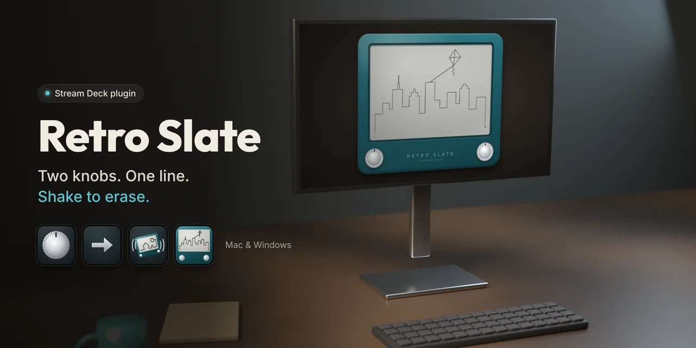
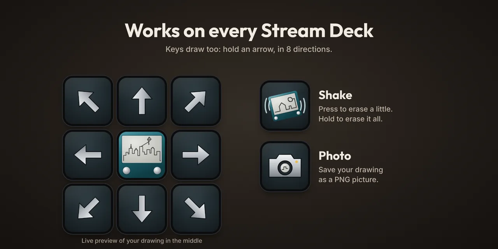
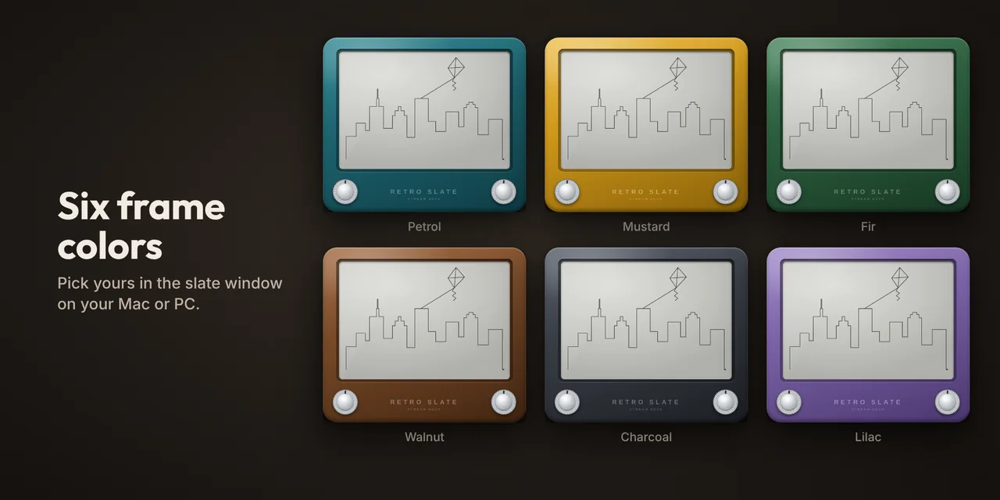

# Retro Slate · Ardoise rétro



**Plugin Stream Deck gratuit de [Studio Thelba](https://creation-thelba.com/ardoise-retro.html).** · *[English below](#english)*

L'ardoise à dessin rétro, au bout des molettes. Tournez deux molettes du Stream Deck + pour tracer un seul trait à l'écran, puis secouez pour effacer. Les flèches dessinent aussi, sur tous les Stream Deck. Une pause qui détend, un moment avec les enfants ou un échauffement créatif.

## Télécharger

**[⬇ Télécharger Retro Slate (dernière version)](https://github.com/zedoc84/retro-slate/releases/latest/download/Retro-Slate.streamDeckPlugin)**

Toutes les versions sont dans l'onglet [Releases](https://github.com/zedoc84/retro-slate/releases).

## Installer

Il faut l'application [Stream Deck](https://www.elgato.com/downloads) 7.1 ou plus récente, sur macOS 12 ou Windows 10 et plus récents.

1. Téléchargez le fichier `Retro-Slate.streamDeckPlugin`.
2. Double-cliquez dessus : Stream Deck vous demande de confirmer l'installation.
3. Les actions apparaissent dans la catégorie **Ardoise rétro**. Faites-les glisser sur vos touches et vos molettes.

## Régler le Stream Deck

**Stream Deck +** (le plus proche du jouet)
1. Glissez **Molette** sur deux molettes. En réglage *Auto*, celle de gauche trace à l'horizontale, celle de droite à la verticale.
2. Tourner : tracer. Appuyer : vitesse (fin, normal, rapide). Toucher l'écran : secouer. Appui long sur l'écran : tout effacer.
3. Mettez **Ardoise** sur une touche : le dessin s'affiche en direct dessus.

**Stream Deck MK.2, XL, Mini, Neo, Mobile**
1. Quatre (ou huit) **Flèche** : la direction se choisit dans l'inspecteur. Maintenez pour tracer ; le trait accélère.
2. **Secouer** : un appui efface un peu, par plaques ; maintenir une seconde efface tout.
3. **Ardoise** (aperçu, ouvre la fenêtre) et **Photo** (enregistre l'image).



## Les cinq actions

| Action | Ce qu'elle fait |
|---|---|
| **Molette** | Stream Deck + : tourner pour tracer, appuyer pour la vitesse, toucher l'écran pour secouer, appui long pour tout effacer. |
| **Flèche** | Tous les Stream Deck : maintenir pour tracer dans l'une des 8 directions, avec accélération. |
| **Secouer** | Un appui efface un peu ; maintenir une seconde efface tout. |
| **Ardoise** | Le dessin en direct sur la touche. Un appui ouvre la fenêtre de l'ardoise. |
| **Photo** | Enregistre le dessin en image PNG dans **Images › Ardoise rétro**. |

## La fenêtre de l'ardoise

Elle s'ouvre dans votre navigateur, à l'adresse `http://127.0.0.1:47312/` : avec la touche Ardoise, le bouton de l'inspecteur, ou toute seule au premier tour de molette.

- Six couleurs de cadre, plein écran (**F**), aide (**?**).
- Clavier : flèches (Maj = rapide, Alt = fin), Espace = secouer, Suppr = tout effacer, P = photo.
- Souris : faites tourner les boutons à l'écran (en glissant ou avec la molette de la souris).
- Le dessin est gardé quand on éteint, comme sur la vraie.



## Rien ne sort de votre ordinateur

L'ardoise fonctionne entièrement sur l'ordinateur. Le plugin n'écoute que sur 127.0.0.1 : rien n'est exposé au réseau, et il refuse les requêtes qui ne viennent pas de l'ordinateur lui-même. Pas de compte, pas de connexion à Internet, aucune donnée collectée.

## Mettre à jour

Ce plugin n'est pas distribué par l'Elgato Marketplace, donc il ne se met pas à jour tout seul. Pour passer à une nouvelle version, téléchargez-la ici et double-cliquez dessus, comme pour la première installation. Les changements sont listés dans [CHANGELOG.md](CHANGELOG.md).

## Développer

Il faut Node.js 24. La CLI Stream Deck d'Elgato (`@elgato/cli`) est installée par `npm install`.

```bash
npm install
npm run icons      # régénère les images (Python 3 + rsvg-convert)
npm run build      # compile src/ → com.medilase.retro-slate.sdPlugin/bin/plugin.js
npm run watch      # recompile et relance le plugin à chaque modification
npm run validate   # streamdeck validate
npm run pack       # crée dist/com.medilase.retro-slate.streamDeckPlugin
npx tsx tools/dev.ts   # banc d'essai sans Stream Deck (fenêtre sur le port 47312)
```

| Fichier | Rôle |
|---|---|
| `src/engine.ts` | L'ardoise : position, traits, secousse par plaques, sauvegarde, aperçus SVG |
| `src/server.ts` | Serveur local : fenêtre, flux en direct (SSE), réception des photos |
| `src/actions/knob.ts` | Molette du Stream Deck + (axe auto, vitesse, écran tactile) |
| `src/actions/keys.ts` | Flèche, Secouer, Ardoise, Photo |
| `src/web/index.html` | La fenêtre de l'ardoise (intégrée au code à la compilation) |
| `com.medilase.retro-slate.sdPlugin/ui/` | Inspecteurs de propriétés (sans dépendance externe) |

## Aide

Pour signaler un problème, ouvrez une [issue](https://github.com/zedoc84/retro-slate/issues) ou écrivez à contact@creation-thelba.com.

## Licence

Gratuit et open source, sous licence [MIT](LICENSE).

Stream Deck est une marque d'Elgato. Retro Slate est un plugin indépendant : il n'est ni affilié à Elgato, ni approuvé par Elgato.

---

<a id="english"></a>

# Retro Slate (English)

**Free Stream Deck plugin by [Studio Thelba](https://creation-thelba.com/en/retro-slate.html).**

The retro drawing slate, at your fingertips. Turn two Stream Deck + dials to draw one continuous line on your screen, then shake to erase. The arrow keys draw too, on every Stream Deck. A relaxing break, a fun moment with the kids or a creative warm-up.

## Download

**[⬇ Download Retro Slate (latest version)](https://github.com/zedoc84/retro-slate/releases/latest/download/Retro-Slate.streamDeckPlugin)**

All versions are in the [Releases](https://github.com/zedoc84/retro-slate/releases) tab.

## Install

You need the [Stream Deck](https://www.elgato.com/downloads) app 7.1 or later, on macOS 12 or Windows 10 or later.

1. Download the `Retro-Slate.streamDeckPlugin` file.
2. Double-click it: Stream Deck asks you to confirm the installation.
3. The actions appear in the **Retro Slate** category. Drag them onto your keys and dials.

## Set up your Stream Deck

**Stream Deck +** (closest to the toy)
1. Drag **Knob** onto two dials. In *Auto* mode, the leftmost one draws horizontally and the other vertically.
2. Turn: draw. Press: speed (fine, normal, fast). Touch the screen: shake. Long touch: erase all.
3. Put **Slate** on a key: your drawing shows live on it.

**Stream Deck MK.2, XL, Mini, Neo, Mobile**
1. Four (or eight) **Arrow** keys: pick the direction in the inspector. Hold to draw; the line speeds up.
2. **Shake**: one press erases a little, in patches; hold for one second to erase everything.
3. **Slate** (preview, opens the window) and **Photo** (saves the picture).

## The five actions

| Action | What it does |
|---|---|
| **Knob** | Stream Deck +: turn to draw, press for speed, touch the screen to shake, long touch to erase all. |
| **Arrow** | Every Stream Deck: hold to draw in one of 8 directions, with acceleration. |
| **Shake** | One press erases a little; hold for one second to erase everything. |
| **Slate** | Live preview of your drawing on the key. Press to open the slate window. |
| **Photo** | Saves your drawing as a PNG picture in **Pictures › Retro Slate**. |

## The slate window

It opens in your web browser at `http://127.0.0.1:47312/`: with the Slate key, the inspector button, or by itself on the first turn of a dial.

- Six frame colors, full screen (**F**), help (**?**).
- Keyboard: arrows (Shift = fast, Alt = fine), Space = shake, Delete = erase all, P = photo.
- Mouse: turn the on-screen knobs (drag or use the mouse wheel).
- Your drawing is kept when you turn things off, just like the real one.

## Nothing leaves your computer

The slate runs entirely on your computer. The plugin only listens on 127.0.0.1: nothing is exposed to the network, and it refuses requests that don't come from the computer itself. No account, no internet connection, no data collected.

## Updating

This plugin is not distributed through the Elgato Marketplace, so it does not update itself. To get a new version, download it here and double-click it, just like the first install. Changes are listed in [CHANGELOG.md](CHANGELOG.md).

## Development

You need Node.js 24; Elgato's Stream Deck CLI (`@elgato/cli`) is installed by `npm install`. The commands are listed in the French section above (`npm install`, `npm run build`, `npm run pack`…).

## Help

To report a problem, open an [issue](https://github.com/zedoc84/retro-slate/issues) or email contact@creation-thelba.com.

## License

Free and open source, under the [MIT](LICENSE) license.

Stream Deck is a trademark of Elgato. Retro Slate is an independent plugin, not affiliated with or endorsed by Elgato.
